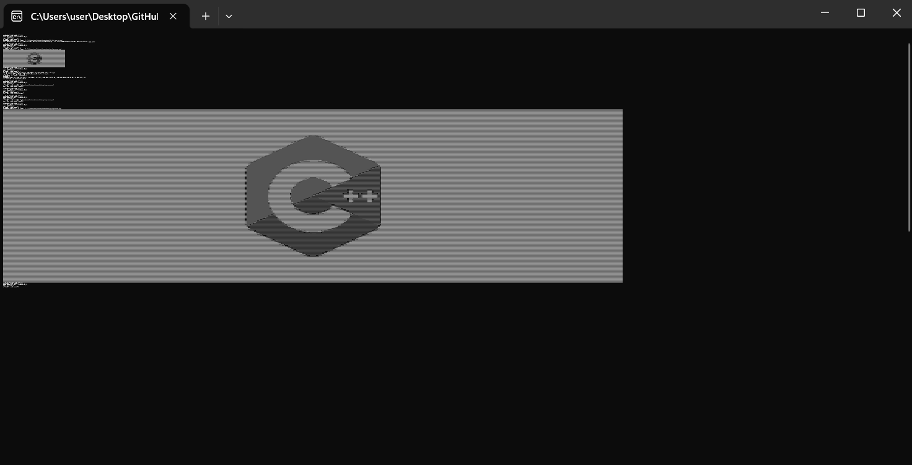

# ASCII Art Converter

Конвертор изображений в ASCII-арт на C++ с использованием библиотеки `stb_image`.

## Возможности

- Поддержка форматов JPG и PNG.
- Автоматическое изменение размера с сохранением пропорций.
- Настройка максимальной ширины арта (от 1 до 750 пикселей).
- Настройка соотношения сторон (коэффициент вытянутости) для компенсации прямоугольности символов.
- Интерактивное меню с выбором файла и настроек.
- Консольный вывод готового ASCII-арта.

## Требования

- Компилятор с поддержкой C++17.
- CMake 3.5 или выше.

## Сборка

  ```
    mkdir build
    cd build
    cmake ..
    cmake --build .
  ```

Исполняемый файл появится в папке `build/`.

## Использование

После запуска программа предлагает меню:

  ```
  Конвертировать [1]
  Изменить настройки [2]
  Закрыть [3]
  Выбор команды:
  ```

- **1** – конвертация: введите путь к файлу (можно в кавычках или без). Поддерживаются пути с пробелами.
- **2** – настройки:
    - Задать максимальную ширину арта (рекомендуется 40–400).
    - Задать соотношение сторон (коэффициент вытянутости, рекомендуется около 2.5).
- **3** – выход.

Программа выведет ASCII-арт прямо в консоль.

### Пример вывода (скриншот прилагается)



## Настройки

- **Максимальная ширина** – ограничивает ширину арта в символах. Изображение пропорционально уменьшается, чтобы вписаться в эту ширину.
- **Соотношение сторон** – корректирует растяжение по горизонтали, так как символы обычно выше, чем шире. Значение 2.5 означает, что ширина будет увеличена в 2.5 раза относительно исходной расчётной.

## Важные замечания

### Совместимость с Windows

На **Windows** могут возникать проблемы с отображением русских символов в консоли. ASCII-арт использует только символы латиницы и пунктуации ( `. ' ^ " , : ; < | \ / t r W @ % $` ), поэтому сам арт отображается корректно, но сообщения программы на русском языке могут выводиться с кракозябрами, если не настроена кодировка.

Если сообщения на русском не критичны, можно игнорировать – сам арт будет нормальным.

### Пути к файлам

При вводе пути можно использовать как прямые слэши `/`, так и обратные `\`. Если путь содержит пробелы, рекомендуется заключить его в двойные кавычки (программа автоматически удалит кавычки).

### Допустимые форматы

Поддерживаются только **JPG** и **PNG** (расширения `.jpg`, `.jpeg`, `.png`).

## Лицензия

Проект использует библиотеку `stb_image` (Public Domain) и `sqlite3` (Public Domain). Исходный код предоставляется для образовательных целей.
